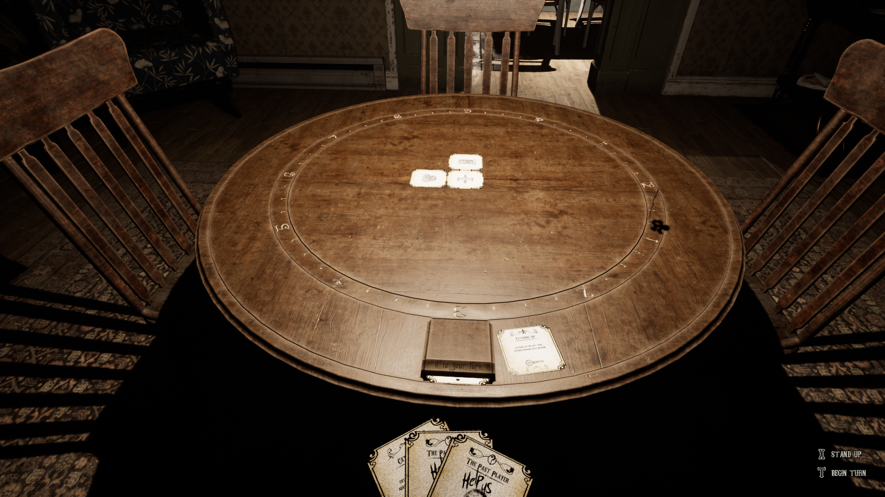

# CabinFastTurns

> 🛟 **Need help or found a bug?** Get support at [support.doodesch.de/fastturns](https://support.doodesch.de/fastturns).

Speeds up selected table, card and board-piece transitions at 2x by default. Intro and minigame timers keep their original pace.

## Installation

Requires UE4SS `v3.0.1-1164-g5e627997`, installed separately. Target game version: Steam build `25553694` (Unreal 5.5).

1. Close the game and install UE4SS.
2. Copy the archive's `Mods/CabinFastTurns` folder into `the_cabin_game/Binaries/Win64/ue4ss/Mods`.
3. Copy the archive's `the_cabin_game/Content/Paks/~mods` files into the same path in your game folder. Keep `CabinFastTurns_P.pak`, `CabinFastTurns_P.utoc` and `CabinFastTurns_P.ucas` together.

Every participating multiplayer client needs both the Lua mod and the overlay container files.

## Settings

The mod is enabled by default with a turn speed of 2x. Install the optional CabinModSettings mod to change turn speed from 1x to 5x or disable the mod through the Settings card. Without CabinModSettings, CabinFastTurns uses its defaults and its own validated settings file.

The host controls these settings. Changes take effect next round.

## Removal

Close the game. Back up `Mods/CabinFastTurns/Scripts/settings.dat` if you want to keep your preferences, then remove the `Mods/CabinFastTurns` folder and the three `CabinFastTurns_P` container files.

## Building from source

Use Python 3.13. Install development dependencies with `python -m pip install -r requirements-dev.txt`, run `python -m unittest discover -s tests -v` and `python tests/check_lua.py`, then build with `python tools/package.py`.

The builder writes a ZIP and checksum to `dist` using the committed overlay containers. See [publishing](docs/publishing.md) for release checks and [Nexus description](docs/nexus.md) for listing text.
